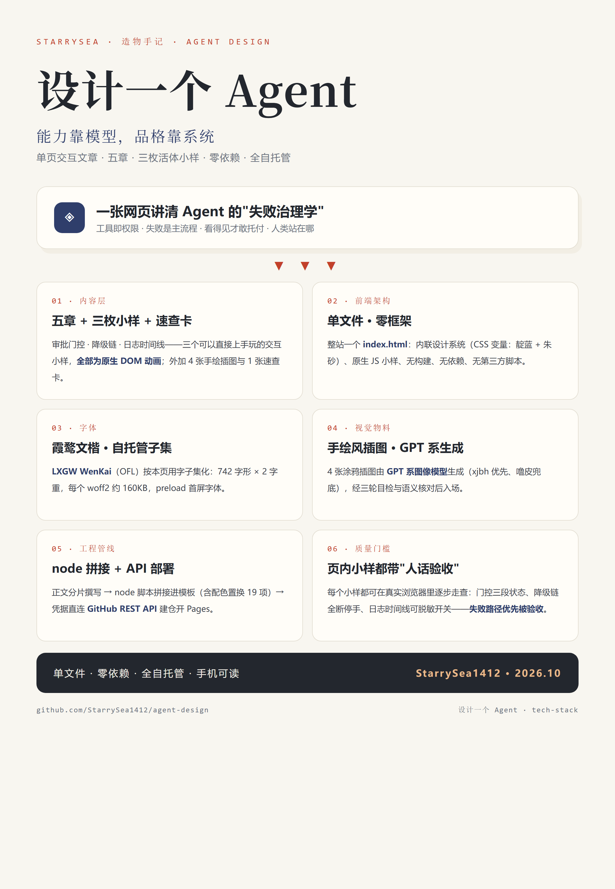

# 设计一个 Agent · 造物手记

不聊玄学。一个敢上生产的 Agent，设计的核心不是它多聪明，而是**它出错的样子**：工具怎么被约束、失败怎么降级、日志怎么留痕、人类在哪一站上台。以下每一条原则，都来自我桌上真实跑着的那些 Agent。

**[打开这一页 →](https://starrysea1412.github.io/agent-design/)**

五章正文 + **三枚可以直接上手玩的小样**（审批门控 / 降级链 / 日志时间线）+ 速查卡，4 张手绘插图。

> 原则出处：hermes-agent-workbench（受控审批 · 可回滚工具执行）· 渠道探测 Agent 的探测纪律与时间线日志 · 图片工坊的候选降级链 · 剪辑人审工作台 · 3dviz-pro-max 十步工作流。

---

单页站点由 `index.html` 单文件承载（零构建、零依赖）；小样全部为原生 DOM 动画；字体为霞鹜文楷（OFL）子集化自托管（`assets/fonts/`）；插图为 GPT 系图像模型生成。
